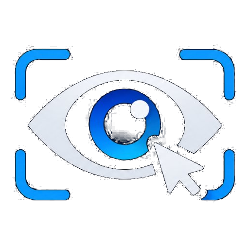

# EyeControl 👁️🖥️

<div align="center">
  
  <p><em>Rastreador de Atenção Visual e Alternador de Janelas Flutuantes para Múltiplos Monitores no Windows.</em></p>
</div>

---

O **EyeControl** é uma aplicação desktop leve em Python projetada para quem trabalha ou joga com múltiplos monitores e utiliza janelas sobrepostas — como o espelhamento de celular via [scrcpy](https://github.com/Genymobile/scrcpy), vídeos em Picture-in-Picture (PiP do YouTube/Twitch) ou reprodutores de mídia fixados com o *Always on Top* do PowerToys.

Em vez de arrastar janelas manualmente com o mouse toda vez que você olha para outro monitor, o EyeControl rastreia a inclinação da sua cabeça e olhar via webcam e **transporta a janela automaticamente para a tela onde sua atenção está**, posicionando-a no seu campo periférico para não obstruir sua visão direta.

---

## ✨ Principais Recursos

* 🎯 **Calibração Rápida em 2 Pontos (Cruz + Barra de Espaço):**
  * Projetada para funcionar mesmo se sua webcam for móvel ou estiver posicionada em ângulos assimétricos (em cima de um monitor, na lateral da mesa, etc.).
  * Coleta a mediana de 5 amostras para descartar piscadas ou solavancos involuntários ao pressionar a tecla.
* 🖥️ **Painel Visual de Monitores (Estilo Windows 11):**
  * Interface visual inspirada nas Configurações de Tela do Windows 11 com botão **"Identificar"** nativo (projeta o número "1" e "2" em cada monitor por 2 segundos).
  * Suporta monitores empilhados na **Vertical** (acima ou abaixo) e monitores lado a lado na **Horizontal** (à direita ou à esquerda), inclusive com resoluções ou tamanhos físicos diferentes (1080p, 4K, Ultrawide, etc.).
* 📹 **Detecção de Webcams com Nomes Reais:**
  * Lista os nomes reais dos dispositivos de vídeo conectados via DirectShow (ex.: *Logi C270 HD WebCam*, *NVIDIA Broadcast*, *OBS Virtual Camera*), permitindo alternar entre câmeras sem reiniciar a aplicação.
* 🔍 **Pesquisa do Windows (Menu Iniciar):**
  * Registra automaticamente o atalho oficial do aplicativo no Menu Iniciar. Após a primeira execução, basta pressionar a tecla `Windows` e digitar `eyecontrol` para localizá-lo com seu ícone nativo.
* 🛡️ **Compatibilidade com PowerToys (Zero Admin):**
  * Não requer privilégios de Administrador (opera em nível médio de integridade respeitando o isolamento de UIPI do Windows).
  * Reposiciona as janelas usando as flags `SWP_NOZORDER` e `SWP_NOACTIVATE` da Win32 API, **sem roubar o foco de digitação** e **sem desativar o *Always on Top* do PowerToys**.
* ⚡ **Ultraleve em Consumo de Hardware:**
  * Amostragem padrão travada em **5 FPS** e processamento interno em baixa resolução ($320 \times 240$), consumindo menos de **1.5% de CPU** e menos de **80 MB de RAM**.
* 🚫 **Zona Morta Anti-Tremor (*Deadzone*):**
  * Limiar de deslocamento configurável (10px a 150px) para ignorar micro-movimentos involuntários dos olhos e ruídos de iluminação da câmera.
* 🎛️ **Deslocamento Periférico (*Offset*):**
  * Escolha afastar a janela para a Esquerda, Direita, Cima ou Baixo por uma distância configurável em pixels, com *clamping* automático para nunca ultrapassar as bordas da tela ativa.
* ⌨️ **Atalho Global de Alternância (*Toggle ON/OFF*):**
  * Pressione o atalho configurável (padrão: `Ctrl + F9`) para ligar ou desligar o rastreamento a qualquer momento.
  * Ao desligar, a janela **congela na posição atual**.
* 📷 **Liberação Automática da Webcam:**
  * Ao pausar o rastreamento, o EyeControl libera a webcam (`cap.release()`), permitindo abrir reuniões no Google Meet, Discord ou transmissões no OBS sem disputa de porta USB.

---

## 🚀 Como Executar

### Pré-requisitos
* Sistema Operacional: Windows 10 ou Windows 11.
* Python 3.10 ou superior instalado (marcando a opção *"Add Python to PATH"* durante a instalação).

### Modo 1: Inicialização Automática (Recomendado)
Basta dar dois cliques no arquivo:
```cmd
run.bat
```
> **Nota:** Na primeira execução, o script criará automaticamente o ambiente virtual `.venv`, atualizará o `pip`, instalará as dependências do `requirements.txt` e iniciará o programa. Nas execuções seguintes, a abertura será instantânea.

### Modo 2: Via Terminal Manual
Se preferir executar manualmente via PowerShell ou Prompt de Comando:
```powershell
# 1. Clone o repositório
git clone https://github.com/NewtonThomaz/EyeControl.git
cd EyeControl

# 2. Crie e ative o ambiente virtual
python -m venv .venv
.\.venv\Scripts\activate

# 3. Instale as dependências
pip install -r requirements.txt

# 4. Inicie o EyeControl
python -m src.main
```

---

## 🛠️ Como Usar

1. **Selecione a Janela Alvo:** Abra o programa que deseja controlar (*scrcpy*, janela PiP do navegador, reprodutor de vídeo, etc.) e selecione-o no dropdown (ou clique em `↻ Atualizar`).
2. **Defina a Disposição dos Monitores:** No painel visual, selecione onde seu monitor secundário está posicionado na mesa em relação ao monitor principal (`⬆️ Acima`, `⬇️ Abaixo`, `➡️ À Direita`, `⬅️ À Esquerda`). Você pode clicar em `🔍 Identificar` para confirmar qual monitor é o 1 e qual é o 2.
3. **Calibre em 2 Pontos:** Clique em `🎯 Iniciar Calibração de 2 Pontos`:
   * Olhe para o centro da cruz no Monitor 1 e pressione `ESPAÇO`.
   * Olhe para o centro da cruz no Monitor 2 e pressione `ESPAÇO`.
4. **Ative o Rastreamento:** Pressione o atalho `Ctrl + F9` (ou clique em `INICIAR RASTREAMENTO`). Ao mover seu foco de visão entre as telas, a janela acompanhará o seu olhar de forma fluida e periférica!

---

## 🧪 Testes Automatizados

O projeto inclui suíte de testes unitários cobrindo o mapeamento geométrico para layouts verticais e horizontais, filtro de mediana, deadzone, clamping e persistência:

```powershell
.\.venv\Scripts\python.exe -m unittest discover -s tests -v
```

---

## 📦 Tecnologias Utilizadas

* [Python 3.10+](https://www.python.org/)
* [OpenCV](https://opencv.org/) (`cv2` com backend DirectShow)
* [MediaPipe Face Mesh / FaceLandmarker](https://developers.google.com/mediapipe)
* [pywin32](https://github.com/mhammond/pywin32) (Win32 API nativa: `SetWindowPos`, `EnumDisplayMonitors`, `EnumWindows`)
* [CustomTkinter](https://customtkinter.tomschimansky.com/) (Interface gráfica moderna e thread-safe)
* [pynput](https://github.com/moses-palmer/pynput) (Atalhos globais de teclado sem elevação de privilégios)
* [pygrabber](https://github.com/bunkahle/pygrabber) (Descoberta dos nomes reais de dispositivos de captura de vídeo DirectShow)
* [Pillow](https://python-pillow.org/) (Tratamento e renderização de ícones)

---

## 📄 Licença

Distribuído sob a licença MIT. Consulte o arquivo [LICENSE](LICENSE) para mais informações.
